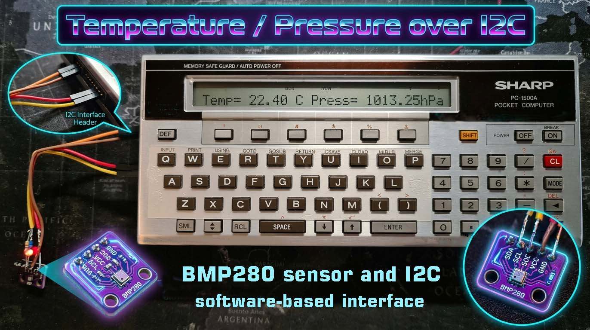
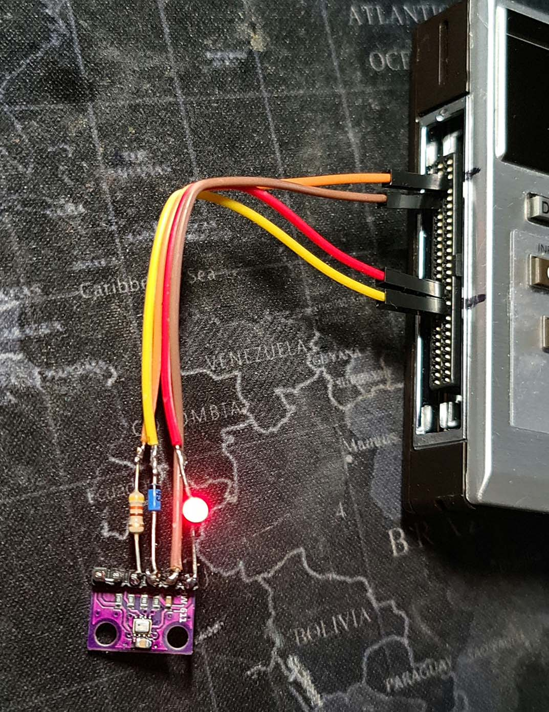
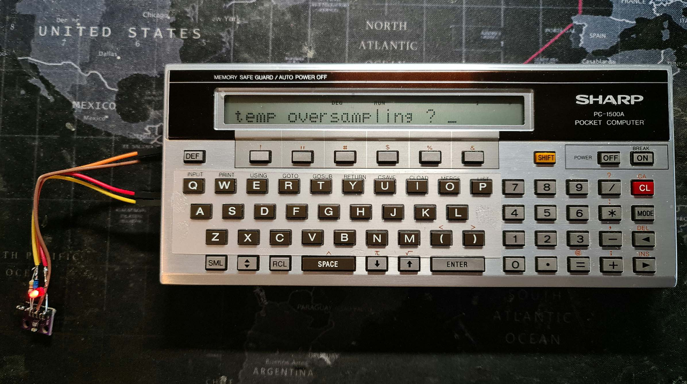

# Thermometer and barometer with a BMP280 on the Sharp PC-1500(A)

<p align="center">
  
</p>

A BASIC program for the PC-1500(A) that reads a **Bosch BMP280** pressure and temperature sensor
over the [I2C interface](README.md) and shows the results on the display, first the temperature 
and then the pressure:

```
Temperature = 25.08 C
Pressure = 1006.53 hPa
```

Each text stays for about 2 seconds, then the next measurement starts. At the start the program
asks for the oversampling of the temperature and of the pressure and for the strength of the
sensor's IIR filter, so you can choose between fast, low-noise and "weather station" settings.

> **Status:** version 1.3 of the program works on a real PC-1500(A) with I2C v1.4 and a BMP280.

| File | Contents |
|---|---|
| [`Basic/pc1500_bmp280-v1.3.txt`](Basic/pc1500_bmp280-v1.3.txt) | the program as a BASIC text file (77 lines, about 2.7 KB) |
| [`wav/bmp280_v1.3.wav`](wav/bmp280_v1.3.wav) | tape recording for `CLOAD` (name on the tape: `BMP280`) |

## Contents

1. [What you need](#1-what-you-need)
2. [Connection](#2-connection)
3. [Loading and starting](#3-loading-and-starting)
4. [Using the program](#4-using-the-program)
5. [Choosing the settings](#5-choosing-the-settings)
6. [Reading the values](#6-reading-the-values)
7. [How the program works](#7-how-the-program-works)
8. [Changing the program](#8-changing-the-program)
9. [Error messages and troubleshooting](#9-error-messages-and-troubleshooting)

---

## 1. What you need

- a **Sharp PC-1500A** (or a PC-1500 with enough RAM: the program is about 2.7 KB, so it does not
  fit into a PC-1500 with only 2 KB),
- the **I2C interface v1.4** in the computer's memory, see
  [Installation in the README](README.md#installation) or the [QUICK_START.md](QUICK_START.md),
- a **BMP280 module** with an I2C interface (or I2C + SPI),
- one **Schottky diode** (BAT43, BAT85, 1N5817; 1N4148 also works), one **470 Ω resistor**, wires,
- if the module is a bare BMP280 without a voltage regulator, then you need a 3.3 V regulator or a red LED, as a voltage dropper,
- a way to play the tape recording into the computer (audio output of a PC or player to the EAR
  jack of the CE-150), or patience to type the program in.

## 2. Connection

The pins are those of the 60-pin connector on the left side of the PC-1500(A), the same as for
every other I2C device (see [Connection in the README](README.md#connection)):

| PC-1500 | Pin | Goes to | BMP280 module |
|---|---|---|---|
| PC7 | 10 | Schottky diode, **cathode (stripe) toward PC7** | SCL (SCK) |
| PB2 (CMT IN) | 27 | 470 Ω resistor | SDA (SDI) |
| GND | 52–55 | (directly) | GND |
| Vcc | 11–12 | 3.3V regulator or red LED forward direction | VCC (3V)

```
PC-1500 (60-pin)                                         BMP280 module
            Schottky diode
PC7  pin 10  ────────|<|──────────┬─────────────────────  SCL
            (stripe toward PC7)   |
                                 4.7k   (only if the module has no pull-up)
                                  |
                                 VCC
PB2  pin 27  ─────────[ 470 ohm]──┬─────────────────────  SDA
                                  |
                                 4.7k   (only if the module has no pull-up)
                                  |
                                 VCC
GND  pin 55  ───────────────────────────────────────────  GND
                                                       
Vcc  pin 12  ──────[ red LED or 3.3V regulator]─────────  VCC 3V
                                                          CSB  ← VCC (selects I2C)
                                                          SDO  ← VCC: selects address &77 

```

<p align="center">
  
</p>

*The wiring of the example: the BMP280 module with the 470 Ω resistor, the diode and the red LED
(the lit LED lowers the supply voltage) soldered to its pins, and the four wires going to the
60-pin connector of the PC-1500A.*

- **Remove the PC-1500(A) from the CE-150 while the I2C bus is in use** (PB2 is the cassette input
  of the CE-150). Load the tape recording with the computer docked, then take it out.
- **Supply:** the BMP280 is a 3.3 V sensor. It draws little current, approx. 0.2 mA. Its supply
  voltage is 1.7–3.6 V. Therefore it cannot be powered directly from the 4.7 V Vcc output of
  the PC-1500. A 3.3 V regulator (or a regulator module) is needed, or, more simply, you can use
  a red LED (the forward voltage drop of a red LED is approx. 1.7–2 V, which lowers the supply
  voltage to a level the BMP280 accepts).   A regulator is the safer solution, but the LED also works.
- join the grounds.
- **SCL:** the diode lets the PC-1500 only pull SCL low; the pull-up of the module makes the high
  level, so the sensor never sees the 5 V of the PC7 output.
- **SDA:** the 470 Ω resistor limits the current. The PC-1500 reads about 2.4 V or more as a high
  level, so the 3.3 V of the module is enough. For the short high pulses that PB2 may produce, see
  [How it works in the README](README.md#how-it-works). For a permanent installation a BSS138
  bidirectional level converter on SDA removes the question.
- **Pull-ups, if not in the BMP280 moduke:** 4.7–10 kΩ to the supply of the module, only if the
  module has none (most modules have them on board; then add nothing).
- **CSB and SDO:** CSB must be at VDDIO to enable the I2C mode. SDO sets the last bit of the address
  and must not float: **SDO to VDDIO = address &77** (what the program uses). Most modules have both
  pins wired already.
- **Bus scan:** with the I2C installer still in memory, `RUN 500` lists all devices that answer;
  the BMP280 must appear as `&77`.

## 3. Loading and starting

1. Install the I2C interface once, see the [QUICK_START.md](QUICK_START.md) (part 1): on a
   PC-1500A PRO mode, `NEW0`, `NEW &4500`, `CLOAD` the installer, `RUN`, then `NEW`. The I2C code
   stays in memory. Other RAM configurations use another `NEW` value, see
   [Memory in the README](README.md#memory).
2. Dock the computer in the CE-150. In **PRO** mode type `CLOAD` [ENTER] (do **not** type `NEW0`
   first: that would remove the I2C code) and play `wav/bmp280_v1.3.wav`.
3. Take the computer out of the CE-150 and connect the sensor (section 2).
4. Switch to **RUN** mode and type `RUN` [ENTER].

## 4. Using the program

1. **`Initialising...`** The program checks that the I2C code is in memory, reads the chip ID of
   the sensor, resets it and reads its calibration data. This takes a moment.
2. **`1,2,4,8,16 ENTER=1`** shows the allowed answers for about 2 seconds. Then three questions
   follow:

   | Question | Meaning |
   |---|---|
   | `temp oversampling ? ` | oversampling of the temperature measurement |
   | `Pres oversampling ? ` | oversampling of the pressure measurement |
   | `IR Filtering ? ` | coefficient of the IIR filter (1 = filter off) |

Enter 1, 2, 4, 8, or 16. Pressing [ENTER] without entering a value selects the default (1). Any other input (e.g. 0 or 3) will prompt you to try again.
You can also simply press [ENTER] to accept the default options. See next paragraph.

<p align="center">
  
</p>

*The PC-1500A in RUN mode asking `temp oversampling ?`, with the BMP280 module connected on the
left.*
4. **Measurement loop.** The program measures once, shows `Temperature = nn.nn C` for 2 seconds,
   then `Pressure = nnnn.nn hPa` for 2 seconds, and measures again.
5. **Stopping.** A key that is pressed when the cycle ends stops the program with `STOPPED`; the
   BREAK key also stops it at any time.

## 5. Choosing the settings

**Oversampling** (answers to the first two questions). Every doubling reduces the noise and adds
one bit of resolution, but makes the measurement longer. Values from the BMP280 datasheet:

| Answer | Oversampling | Pressure resolution | Temperature resolution |
|---|---|---|---|
| 1 | ×1 | 16 bit / 2.62 Pa | 16 bit / 0.0050 °C |
| 2 | ×2 | 17 bit / 1.31 Pa | 17 bit / 0.0025 °C |
| 4 | ×4 | 18 bit / 0.66 Pa | 18 bit / 0.0012 °C |
| 8 | ×8 | 19 bit / 0.33 Pa | 19 bit / 0.0006 °C |
| 16 | ×16 | 20 bit / 0.16 Pa | 20 bit / 0.0003 °C |

The datasheet recommends temperature ×1 for pressure ×1 … ×8, and temperature ×2 for pressure
×16; more temperature oversampling does not improve the pressure noticeably, because the noise of
the pressure depends mainly on the raw pressure.

**Measurement time** (maximum, datasheet) of one measurement in forced mode:

| Pressure | Temperature | Maximum time |
|---|---|---|
| ×1 | ×1 | 6.4 ms |
| ×2 | ×1 | 8.7 ms |
| ×4 | ×1 | 13.3 ms |
| ×8 | ×1 | 22.5 ms |
| ×16 | ×2 | 43.2 ms |

The program waits until the sensor is ready, so these times only add to the time of the BASIC
statements; the two 2-second display times dominate anyway.

**IIR filter** (answer to the third question). The sensor smooths the output over successive
measurements: `new = (old × (n − 1) + measured) / n`, with n = the answer. It suppresses short
disturbances (a door slammed, a draught) but also delays real changes:

| Answer | Filter coefficient | Measurements to reach 75 % of a step |
|---|---|---|
| 1 | off | 1 |
| 2 | 2 | 2 |
| 4 | 4 | 5 |
| 8 | 8 | 11 |
| 16 | 16 | 22 |

The filter keeps its memory from one forced measurement to the next, so with a strong filter
the first readings after the start still move toward the real value. Typical pressure noise (RMS,
in Pa) for the combinations of pressure oversampling (rows) and filter (columns):

| Pressure oversampling | filter off | 2 | 4 | 8 | 16 |
|---|---|---|---|---|---|
| ×1 | 3.3 | 1.9 | 1.2 | 0.9 | 0.4 |
| ×2 | 2.6 | 1.5 | 1.0 | 0.6 | 0.4 |
| ×4 | 2.1 | 1.2 | 0.8 | 0.5 | 0.3 |
| ×8 | 1.6 | 1.0 | 0.6 | 0.4 | 0.2 |
| ×16 | 1.3 | 0.8 | 0.5 | 0.4 | 0.2 |

**Settings recommended by the datasheet** for typical uses (answers for temperature,
pressure and filter):

| Use case | Temperature | Pressure | Filter |
|---|---|---|---|
| weather monitoring | 1 | 1 | 1 (off) |
| drop detection | 1 | 2 | 1 (off) |
| elevator / floor change detection | 1 | 4 | 4 |
| handheld device, dynamic | 1 | 4 | 16 |
| handheld device, low power | 2 | 16 | 4 |
| indoor navigation | 2 | 16 | 16 |

The datasheet gives these for its own sampling rates; in this program a new measurement starts
about every 4 seconds, so the filter works on measurements made that far apart.

## 6. Reading the values

- **Temperature** is measured by the sensor itself. It includes the self-heating of the sensor
  and the temperature of the board, and is typically above the ambient temperature. The datasheet
  gives ±0.5 °C at 25 °C and ±1 °C between 0 and 65 °C. The range is −40 … +85 °C.
- **Pressure** is the **absolute** pressure at the place of the sensor, in hPa. Range 300 … 1100
  hPa; absolute accuracy typically ±1 hPa (0 … 65 °C), relative accuracy ±0.12 hPa, which
  corresponds to about ±1 m of height difference. Weather reports give the pressure reduced to sea
  level; at a height of h metres above the sea the sensor shows less. A good approximation:
  `p(sea level) = p(measured) / (1 − h / 44330) ^ 5.255`.
- The display shows two decimals; the last digit is below the accuracy of the sensor and only
  useful for watching small changes.

## 7. How the program works

### Program structure

| Lines | Task |
|---|---|
| 10–60 | start: the address of the sensor (`D = &77`), the addresses of the I2C code, check that it is installed |
| 100–170 | **initialising:** read the chip ID (`&D0`), soft reset (`&E0` ← `&B6`), wait until the sensor has copied its calibration (`status` bit 0), read 24 calibration bytes from `&88` |
| 200–250 | convert the calibration bytes to 12 numbers `T1 … T3`, `P1 … P9` (subroutines 900 and 910) |
| 300–390 | **setup:** the three questions (subroutine 800), write the filter into `config` (`&F5`) |
| 400–470 | **one measurement:** start forced mode, wait for the end, read six bytes from `&F7`, assemble the two 20-bit raw values |
| 480–545 | **compensation** of temperature and pressure |
| 600–660 | display, key test, `STOPPED` |
| 700 | read the `status` register (`&F3`) into `S` |
| 800 | convert an answer (1, 2, 4, 8, 16) into 0 … 4 |
| 850 | format a number as text with two decimals |
| 900, 910 | 16-bit value from the calibration bytes (unsigned, signed) |
| 980, 990 | error messages |

### Communication with the sensor

Every register access is one `CALL IC` of the I2C interface (see
[Use in your programs](README.md#use-in-your-programs)): the register address goes into `TX`,
the device address `&77` and the byte counts into `IA`; reading is a write of one byte (the
register address) followed by a read of R bytes, in one transaction.

| Register | Name | Use in the program |
|---|---|---|
| `&D0` | `id` | chip ID: `&58` for the BMP280 (the program also accepts `&56`, `&57` and `&60`, the BME280) |
| `&E0` | `reset` | `&B6` = soft reset |
| `&F3` | `status` | bit 3 `measuring` = 1 during a measurement; bit 0 `im_update` = 1 while calibration is copied |
| `&F4` | `ctrl_meas` | bits 7–5 temperature oversampling, bits 4–2 pressure oversampling, bits 1–0 mode (`01` = forced) |
| `&F5` | `config` | bits 4–2 IIR filter; the standby time and SPI bits stay 0 |
| `&F7 … &FC` | data | pressure MSB, LSB, XLSB, temperature MSB, LSB, XLSB (20 bits each) |
| `&88 … &9F` | calibration | 24 bytes, see below |

Codes of the answers in the registers:

| Answer | 1 | 2 | 4 | 8 | 16 |
|---|---|---|---|---|---|
| oversampling (`ctrl_meas`) | 001 | 010 | 011 | 100 | 101 |
| filter (`config`) | 000 (off) | 001 | 010 | 011 | 100 |

**Forced mode.** After every write of `ctrl_meas` with mode `01` the sensor makes **one**
measurement of temperature and pressure and goes back to sleep. The program therefore writes
`ctrl_meas` before every measurement (line 410), polls the `measuring` bit until it is 0
(line 440, at most 200 times), and then reads all six data bytes in **one burst** (line 450), as
the datasheet requires, so that pressure and temperature belong to the same measurement.

**Raw values.** Each is 20 bits long, the lowest 4 bits are in the upper half of the XLSB byte:

```
UP = MSB * 4096 + LSB * 16 + INT (XLSB / 16)        (lines 460 and 470)
```

### Calibration data

Every sensor has its own 12 correction numbers, stored at the factory and read at the start:

| Register (LSB / MSB) | Name | Type |
|---|---|---|
| `&88` / `&89` | `T1` | unsigned 16-bit |
| `&8A` / `&8B` | `T2` | signed 16-bit |
| `&8C` / `&8D` | `T3` | signed 16-bit |
| `&8E` / `&8F` | `P1` | unsigned 16-bit |
| `&90` … `&9F` | `P2` … `P9` | signed 16-bit each |

A signed value is the 16-bit number minus 65536 if it is above 32767 (subroutine 910).

### Compensation formulas

The program uses the floating-point formulas of the datasheet (appendix 8.1); the PC-1500
calculates with 10 significant digits, which is enough:

```
var1 = (UT / 16384 - T1 / 1024) * T2
var2 = (UT / 131072 - T1 / 8192) ^ 2 * T3
t_fine = var1 + var2
temperature [°C] = t_fine / 5120

var1 = t_fine / 2 - 64000
var2 = var1 ^ 2 * P6 / 32768
var2 = var2 + var1 * P5 * 2
var2 = var2 / 4 + P4 * 65536
var1 = (P3 * var1 ^ 2 / 524288 + P2 * var1) / 524288
var1 = (1 + var1 / 32768) * P1
p = 1048576 - UP
p = (p - var2 / 4096) * 6250 / var1
var1 = P9 * p ^ 2 / 2147483648
var2 = p * P8 / 32768
p = p + (var1 + var2 + P7) / 16
pressure [hPa] = p / 100
```

The pressure formula needs `t_fine`, which comes from the temperature. That is why the
temperature is always measured and why it cannot be switched off in this program.

**Check with the datasheet.** With the sample calibration values and raw values of the datasheet
(page 23: UT = 519888, UP = 415148), the formulas in 10-digit arithmetic give 25.08 °C and
100653.27 Pa = 1006.53 hPa, the values printed in the datasheet.

### Display

The program builds the text `-nn.nn` itself (subroutine 850): it rounds to hundredths, takes the
digits one by one with `INT`, and puts the decimal point and the sign in. It does not use
`PRINT USING` or `ABS`: `tools/pc1500_bas2wav.py` has no tape code for these keywords and would
write them as plain letters, which gives `ERROR 1` after `CLOAD`.

## 8. Changing the program

| Change | How |
|---|---|
| sensor with SDO to GND (address &76) | line 30: `D = &76` |
| display time of each text | `WAIT 128` in line 620 (128 = 2 s, 64 = 1 s, 192 = 3 s) |

## 9. Error messages and troubleshooting

| Message | Meaning and remedy |
|---|---|
| `I2C NOT INSTALLED` | the I2C code is not in memory: install the interface again (`NEW &4500` on a PC-1500A, not a plain `NEW`, before loading the installer), see [Installation](README.md#installation) |
| `I2C ERROR E=1` | no answer at address &77: check the wiring (SCL on pin 10 with the diode, SDA on pin 27), the supply, the pull-ups, CSB and SDO; try `D = &76`; run the scanner `RUN 500` of the installer |
| `I2C ERROR E=2` | the sensor refused a data byte: the bus is disturbed, check the wires and the pull-ups |
| `I2C ERROR E=3` | SDA stays low: short circuit, no pull-up, no supply, or a device holds SDA |
| `BAD CHIP ID n` | another chip answers at the address (`n` in decimal; the BMP280 is 88, &58) |
| `BMP280 TIMEOUT` | the `measuring` bit does not return to 0: the sensor does not work properly |
| temperature higher than the room | normal to some degree: self-heating of the sensor and the board; keep the module away from the PC-1500 and other warm parts |

---

Sources: the BMP280 datasheet (Bosch Sensortec, BST-BMP280-DS001-12, revision 1.15), chapters
3.3 to 3.9, 3.11, 4 and 5 and the compensation formulas of appendix 8.1. The I2C master is described
in the [README](README.md). The program, the recording and this description were made with help
from Claude Code.
